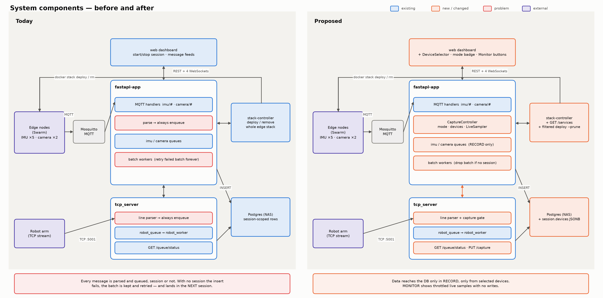
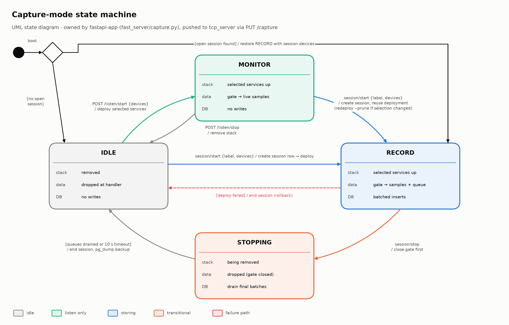
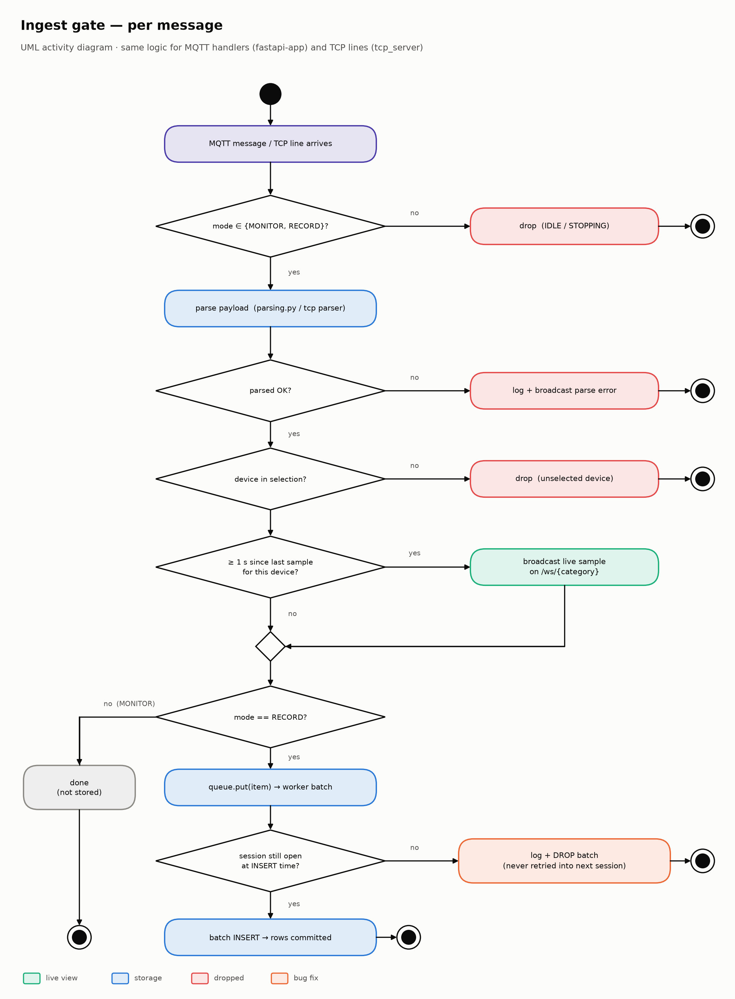
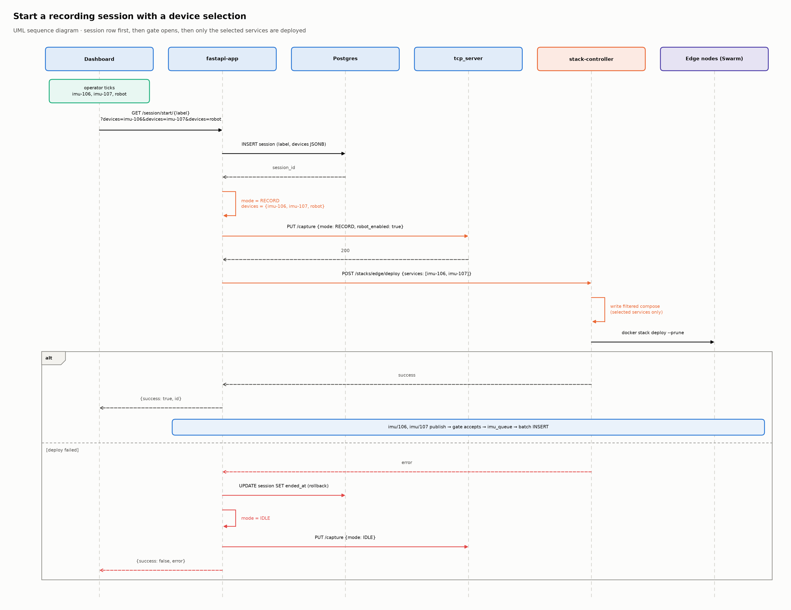
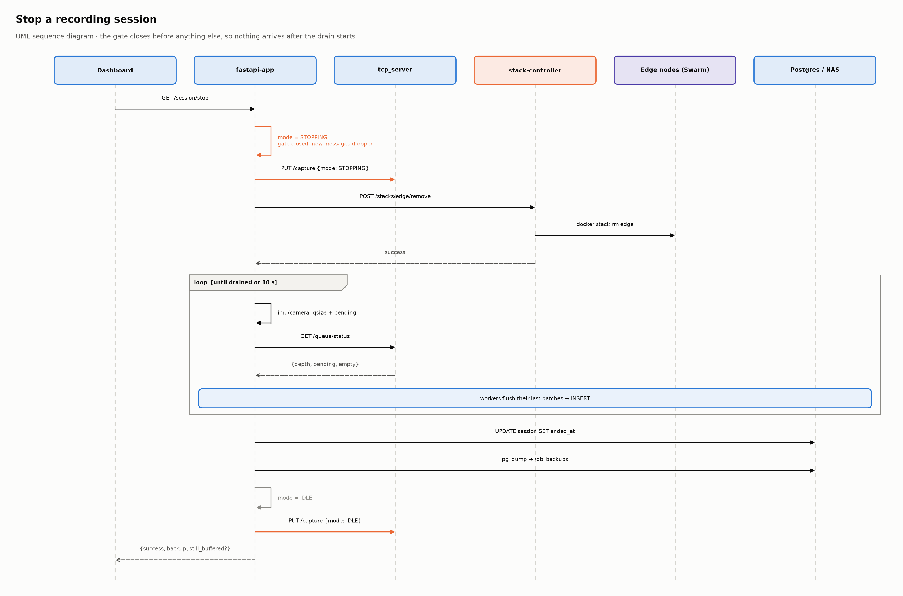
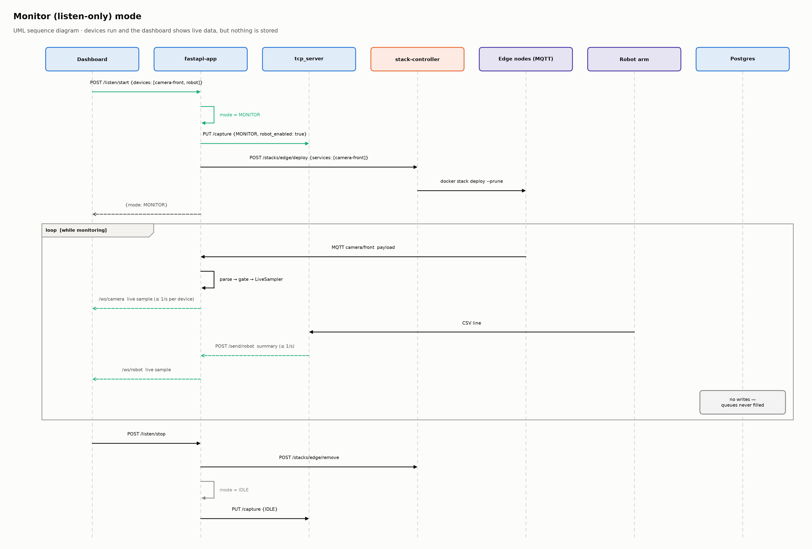
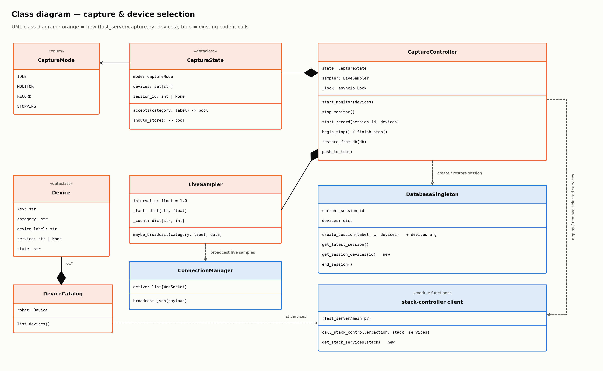
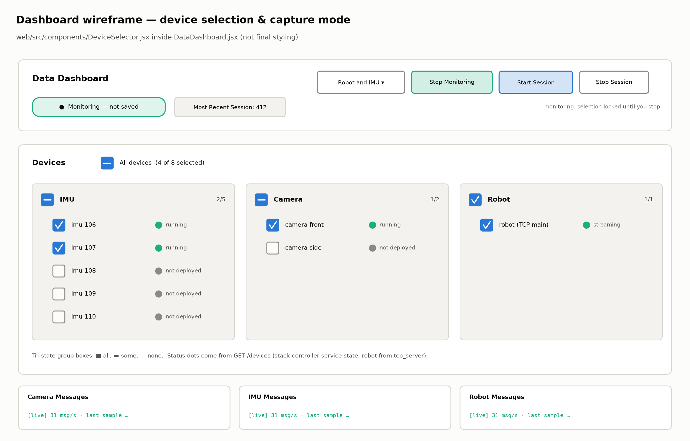

# Listener Switch — Capture Modes & Device Selection

> Plan for the two asks in `listener-switch.md`: (1) only listen to and store data
> when we choose to, with a separate non-storing **monitor** mode for testing, and
> (2) test a subset of the system (all devices, one category, or a single device)
> picked from a checkbox list on the dashboard.
>
> Figures are in `figures/` and are regenerated by `figures/make_diagrams.py`.

---

## 1. Where we are today

| Path | What happens now | Where |
|---|---|---|
| IMU / camera (MQTT) | `fastapi-app` subscribes to `imu/#` and `camera/#` at boot and **always** parses + enqueues every message | `fast_server/main.py` — `handle_sensors`, `handle_camera` |
| Robot (TCP) | `tcp_server` **always** parses + enqueues every line | `tcp_server/tcp_server.py` — `handle_robot` |
| Storage gate | Only the insert itself checks for a session (`SessionNotStarted`) | `db/database.py` — `insert_*_batch` |
| Edge devices | `start_session` deploys the **whole** `edge` stack (5 IMUs + 2 cameras); `stop_session` removes it | `MANAGED_STACKS=edge`, `stack_controller/stacks.yml` |

**Bug found while reviewing:** when an insert fails with `SessionNotStarted`, the
workers (`camera_worker`, `imu_worker`, `robot_worker`) keep the batch and retry
every second without clearing it. Any data that arrives with no session open
piles up in memory and is then written into the *next* session when one starts.
Robot data is the most exposed: the robot is not stopped by `stack rm`, so it
can keep streaming between sessions.

---

## 2. Capture modes

One state machine, owned by `fastapi-app` in a new module `fast_server/capture.py`.
`fastapi-app` is the source of truth and pushes the state to `tcp_server`.

| Mode | Edge stack | Incoming data | Dashboard | Database |
|---|---|---|---|---|
| `IDLE` | removed | dropped at the handler | nothing | nothing |
| `MONITOR` | selected services deployed | parsed, filtered by selection | live samples (≤ 1/s per device) | **nothing** |
| `RECORD` | selected services deployed | parsed, filtered, queued | live samples + "Inserted N rows" | batched inserts |
| `STOPPING` | being removed | dropped (gate closed first) | drain progress / warnings | final flush only |

### Transitions

- **Start monitoring** (`POST /listen/start {devices}`): `IDLE → MONITOR`; deploy the selected services.
- **Stop monitoring** (`POST /listen/stop`): `MONITOR → IDLE`; remove the stack.
- **Start session** (`/session/start/{label}?devices=…`):
  create the session row → `RECORD` → deploy selected services. From `MONITOR`
  with the same selection there is no redeploy, the mode just flips; with a changed
  selection it redeploys with `--prune`. Deploy failure rolls back to `IDLE` and
  ends the session (same "block on failed deploy" rule as today).
- **Stop session** (`/session/stop`): `STOPPING` (gate closes, late messages are
  dropped) → remove stack → existing `drain_queues()` → `end_session()` → backup → `IDLE`.
- **Restart safety:** on startup, if `get_latest_session()` finds an open session,
  restore `RECORD` with that session's stored device selection (§4).

### The ingest gate

Every MQTT message and TCP line goes through the same decision:

- Handlers become: parse → `if not capture.accepts(category, device): return` →
  `sampler.maybe_broadcast(...)` → `if capture.should_store(): queue.put(...)`.
- `LiveSampler` throttles live samples to at most one per device per second (with the
  message rate and the latest values), so monitor mode doesn't flood the WebSockets.
  It reuses the existing `/ws/imu`, `/ws/camera`, `/ws/robot` channels and the
  `MessageWB` component as they are.
- Workers: on `SessionNotStarted`, log the error and **drop** the batch (this fixes
  the leak described in §1).

---

## 3. Robot path (`tcp_server`, separate process)

- Add `PUT /capture` (`{mode, robot_enabled}`) to the existing aiohttp status server
  (`start_status_server`, next to `/queue/status`). On boot, `tcp_server` calls
  `GET http://fastapi-app/capture` to sync, in case it restarted mid-session.
- `handle_robot` keeps reading the socket so the robot connection stays up, but
  drops lines unless robot is selected and the mode is `MONITOR`/`RECORD`.
  `MONITOR` sends a throttled summary through `send_to_fastapi`; `RECORD` also
  enqueues the line.
- `fastapi-app` pushes the state on every transition, using the same aiohttp
  client pattern as `get_robot_queue_status()`.

---

## 4. Device selection

### Device catalog

- Label each service in `deploy/swarm-edge-nodes.yml`:
  `deploy.labels: {smr.category: imu|camera, smr.device: "${IMU_106_DEVICE_ID}"}`.
  This also makes them readable in `docker service inspect` and Portainer.
- New stack-controller endpoint `GET /stacks/{name}/services`: parses the compose
  file with the stack's `env_file` (reuse `load_stack_env`) and returns
  `[{service, category, device_label}]`.
- New `fastapi-app` endpoint `GET /devices`: that list, plus a static `robot` entry,
  plus each service's state from the existing `GET /stacks/{name}/status`.

### Selective deploy

- `POST /stacks/{name}/deploy` accepts an optional body `{"services": [...]}`.
  stack-controller writes a filtered copy of the compose file (only the selected
  services) to a temp path and runs `docker stack deploy --prune`, so changing the
  selection removes services that were de-selected. No body means the full stack,
  so existing callers keep working.
- The ingest gate also drops data from unselected devices, in case something
  publishes from outside Swarm (for example a node started by hand over SSH).

### Persisting the selection

- Migration: `ALTER TABLE session ADD COLUMN devices JSONB;`. Log it in
  `db/migrations.md`, mirror it in `db/schema.sql`, and write it from
  `DatabaseSingleton.create_session(..., devices=...)`.
- This makes "this was an IMU-only run" queryable afterwards and supports the
  restart restore in §2.

---

## 5. API surface (`fastapi-app`)

| Method & path | Purpose |
|---|---|
| `GET /devices` | Device catalog + live per-service state |
| `GET /capture` | Current mode + selected devices (used by the dashboard and by `tcp_server` on boot) |
| `POST /listen/start` `{devices}` | `IDLE → MONITOR` |
| `POST /listen/stop` | `MONITOR → IDLE` |
| `GET /session/start/{label}?…&devices=imu-106&devices=robot` | Adds an optional `devices` list; if it's left out, all devices are used (backward compatible) |
| `GET /session/stop` | Unchanged externally; follows the new `STOPPING` ordering |

---

## 6. Dashboard (`web/src`)

- New `components/DeviceSelector.jsx`: grouped checkboxes (IMU / Camera / Robot),
  each group with a tri-state "select all" box, an "All devices" toggle, and a
  status dot per device. The selection is locked while monitoring or recording.
- New `api/deviceApi.js`: `getDevices`, `getCapture`, `startListening`,
  `stopListening`, built on `apiGet`/`apiPost` from `api/apiClient.js`.
- `DataDashboard.jsx`: a mode badge (Idle / Monitoring — not saved / Recording),
  "Start Monitoring" / "Stop Monitoring" buttons, and `startSession` passes the
  selection through `startSessionByLabel`.
- Optional: preselect devices from the session label (e.g. "Robot and IMU").

---

## 7. Rollout

| Phase | Scope | Delivers |
|---|---|---|
| **A** | Ingest gate, drop-batch fix, `tcp_server` `PUT /capture` (all devices) | Data is stored only during sessions; the leak is fixed |
| **B** | `MONITOR` mode, `LiveSampler`, dashboard buttons + badge | Listen-only testing |
| **C** | Device catalog, selective deploy, `DeviceSelector`, `session.devices` migration | Subset / single-device testing |

## 8. Testing

- Unit (`unittest`, mock queues and managers, like `tests/channel_test.py`):
  `CaptureState.accepts`/`should_store` for every mode; handlers enqueue only in
  `RECORD` and only for selected devices; `LiveSampler` throttling; workers drop
  the batch on `SessionNotStarted`.
- stack-controller: the filtered compose output keeps only the selected services
  and keeps `${VAR}` references un-expanded; `/services` returns category and device.
- Integral (`TestClient`, like `tests/channel_integral_test.py`): listen start/stop,
  session start with `devices`, stop ordering (gate closed before stack removal),
  restore of `RECORD` on startup.
- End to end on `docker-compose.local.yml` with a single-node swarm: monitor a
  single IMU (no new rows in `imu_measurement`), then record IMU-only (rows only for
  that device, `session.devices` set), then robot-only.

## 9. Docs to update when implemented

- `web/docs/operations/running-a-test.md` — new monitor / select-devices steps.
- `web/docs/overview/structure.md` and `CLAUDE.md` — the "Sessions gate everything" bullet now also covers capture modes.
- `db/migrations.md` / `db/schema.sql` — `session.devices`.
