# ArUco markers

The cameras track the robot by the [ArUco](https://docs.opencv.org/4.x/d5/dae/tutorial_aruco_detection.html) markers stuck to it. For every frame, [camera-processor](/docker/camera-processor) finds each marker, estimates its pose relative to the camera, and stores one `image_detection` row per marker (`marker_idx` is the marker's ID). See [Camera nodes](/hardware/camera#marker-pose-data-format) for the row format.

| | |
| --- | --- |
| Dictionary | 4×4 ArUco. The cameras send `aruco_dict: 4x4_50`, so detection uses `DICT_4X4_50`. The image files are named after `DICT_4X4_1000`, which has the same patterns for IDs 0–49, so they're the same markers (each image below decodes to its ID with `DICT_4X4_50`). |
| Default size | 48.5 mm (`CAMERA_MARKER_LENGTH_M=0.0485` in `deploy/.env`) |
| Per-marker sizes | `CAMERA_MARKER_LENGTHS_M` in `deploy/.env` |
| Which IDs are published | every detected marker (no `target_ids` filter is set) |

## Markers on the robot

The robot carries **12 markers**: 0, 1, 2, 3, 4, 5, 6, 7, 8, 9, 15 and 16.

| ID | Marker | Side | Location on robot |
| --- | --- | --- | --- |
| 0 | 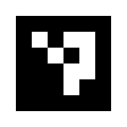 | 170 mm | _TODO_ |
| 1 | 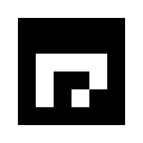 | 48.5 mm (default) | _TODO_ |
| 2 | 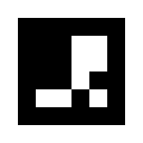 | 48.5 mm | _TODO_ |
| 3 | 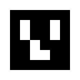 | 50 mm | _TODO_ |
| 4 | 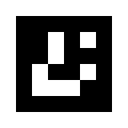 | 70 mm | _TODO_ |
| 5 | 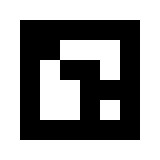 | 75 mm | _TODO_ |
| 6 | 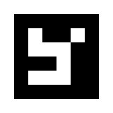 | 100 mm | _TODO_ |
| 7 | 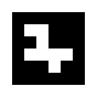 | 140 mm | _TODO_ |
| 8 | 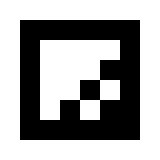 | 170 mm | _TODO_ |
| 9 | 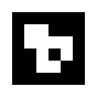 | 60 mm | _TODO_ |
| 15 | 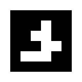 | 48.5 mm (default) | _TODO_ |
| 16 | 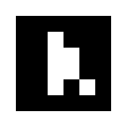 | 48.5 mm (default) | _TODO_ |

"Side" is the length of the marker's outer black square, which is what OpenCV's pose estimate needs. It doesn't include any white margin around it.

::: info Placeholder
TODO: where on the robot each marker is mounted (link, face, orientation).
:::

## Why the size matters

The pose is scaled by the marker's size: `tvec` (the marker's position, in metres) is only correct if the configured side matches the printed one. A marker printed at 100 mm but configured at 48.5 mm looks about twice as far away as it is. The rotation (`rvec`) doesn't depend on the size.

The sizes go to the cameras on each deploy:

```bash
# deploy/.env (the edge stack's .env, not the repo-root one)
CAMERA_MARKER_LENGTH_M=0.0485          # any ID not listed below
CAMERA_MARKER_LENGTHS_M=0:0.170,2:0.0485,3:0.050,4:0.070,5:0.075,6:0.100,7:0.140,8:0.170,9:0.060
```

`CAMERA_MARKER_LENGTHS_M` is `id:metres` pairs, comma-separated. IDs 1, 15 and 16 aren't listed, so they use the default. Each camera Pi sends these values to camera-processor in its retained config message (`marker_length_m`, `marker_lengths_m`). The size used for each row is kept in the run folder's `detections.csv`, not in the database.

## Adding or changing a marker

1. Generate it from the 4×4 dictionary with an ID below 50, so `DICT_4X4_50` can detect it. Keep the IDs unique: two markers with the same ID can't be told apart.
2. Print it at 100% scale and measure the black square.
3. If its size isn't 48.5 mm, add `<id>:<metres>` to `CAMERA_MARKER_LENGTHS_M` in `deploy/.env`. The next Start Monitoring or Start Session deploys it; nothing needs restarting. If the edge is in *Edge standby* ([Keep edge running](/operations/plc-auto-stop#back-to-back-sessions-keep-edge-running)), take it down first so the cameras restart with the new sizes.
4. Add it to the table above, with its image in `web/docs/hardware/aruco-markers/`.

To check that it's detected and has a size, start monitoring and look at camera-processor's logs (`docker logs AMS-camera-processor`): its per-camera line counts frames with markers. The run folder's `annotated/` frames show each marker outlined, with its ID and pose axes ([Camera processor](/docker/camera-processor#what-the-processor-does)).

## Image files

`web/docs/hardware/aruco-markers/` has each marker as `4x4_1000-<id>.png` (160 × 160 px, for this page) and `4x4_1000-<id>.svg`. Each SVG's width and height are set to the marker's side, so printing it at 100% gives the right size.
