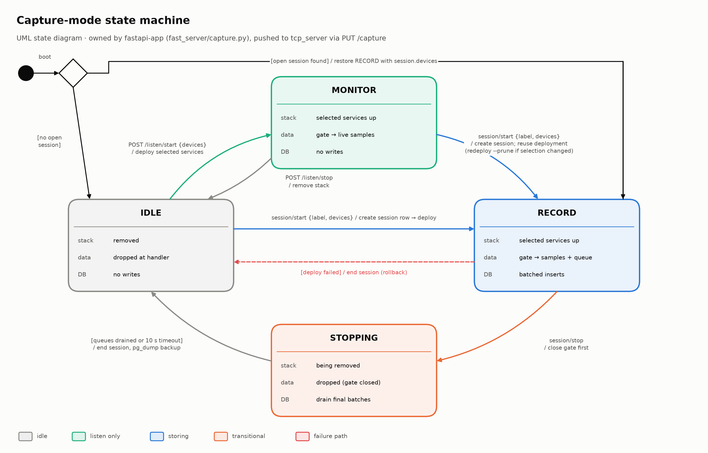

# Sessions & capture modes

Two ideas decide what happens to every message a device sends: the **capture mode** (is the AMS listening, and is it storing?) and the **session** (the database row that stored data belongs to).

## Capture modes

`fastapi-app` owns the capture state (`fast_server/capture.py`) and pushes every change to the robot's `tcp` server (`PUT /capture`). `tcp` also re-checks `GET /capture` every 5 s in case a push was missed. The dashboard shows the mode in the badge next to the session indicator.

| Mode | Badge | Edge devices | Data | Database |
| --- | --- | --- | --- | --- |
| **Idle** | Idle — not listening | stack removed | dropped as it arrives | nothing written |
| **Monitor** | Monitoring — not saved | selected devices running | live samples on the dashboard | nothing written |
| **Record** | Recording | selected devices running | queued for storage (no `[live]` lines; tiles still show rate) | batched inserts into the open session |
| **Stopping** | Stopping — flushing data | being removed | new data dropped | the last batches are written |



*State diagram from the listener-switch design. One later change: starting a session from Monitor also redeploys when the stack settings differ, not only when the selection changed. The IMU PLC trigger and the [run parameters](/operations/run-parameters) are such settings, so by default it redeploys.*

Rules worth knowing:

- **Monitor** can only start from Idle, and only goes back to Idle. A session can start from Idle or from Monitor.
- Only the **selected devices** are let through in Monitor and Record. Anything else, such as a container started by hand or a device on the wrong MQTT topic, is dropped. See [Stack controller & device selection](/docker/stack-controller#step-6-—-the-selection-gates-the-data).
- Each queued item carries its session id. If a batch belongs to a session that has ended, or the database says no session is open, the batch is **dropped rather than carried into the next session**.
- After a restart, `fastapi-app` comes back in Record if the database still has an open session, with that session's device selection. Otherwise it comes back Idle.

## Sessions

A session is one row in the `session` table. Everything stored while recording points to it.

| Column | Set from |
| --- | --- |
| `label` | generated by the dashboard: `<session type>_<UTC time>` |
| `session_label_id` | the session type dropdown (Full System, IMU Only, …); see [Updating the schema](/data/schema-changes#pattern-2-adding-a-new-linked-table) |
| `is_test_session` | the **Fake Data** checkbox (ticked = test) |
| `devices` | the device selection; `NULL` means every device |
| `parameters` | the [run parameters](/operations/run-parameters) the edge devices were deployed with |
| `started_at` / `ended_at` | start and stop times (Unix seconds) |

### Starting

`GET /session/start/{label}` does the following, in order:

1. Checks the selection and the database.
2. Creates the session row.
3. Switches to Record, so the gate is open before devices start.
4. Deploys the edge stack, unless it was already monitoring with the same devices and settings.

If the deploy fails, the session is ended again and the mode goes back to where it was.

### Stopping

The Stop Session button (`GET /session/stop`) and [PLC auto stop](/operations/plc-auto-stop) run the same steps:

1. Switch to Stopping, which closes the gate.
2. Remove the edge stack, and wait until its containers on the Pis have stopped (normally about 4 s, at most `REMOVE_WAIT_S`, 30 s). A start right after can't overlap the old containers, which would share their MQTT client ids and IMU sockets.
3. Wait up to 10 s for the IMU, camera and robot queues to drain.
4. End the session row.
5. Switch to Idle.
6. Start a `pg_dump` backup in the background. It doesn't hold the lock, so the next start isn't held up by it.

Stopping works with the database down too. The stacks still come down, and the end time is written once the database is back.

Session start, session stop, monitor start/stop and run-parameter changes all take one lock (`session_lock`), so they can never interleave. For example, a Stop click and a PLC stop arriving together produce one stop and one backup. `GET /capture` reports `busy: true` while the lock is held, and the dashboard greys out Start Session and Start Monitoring meanwhile.

## Edge readiness

While monitoring or recording, `edge_ready_monitor()` in `fastapi-app` checks the selected edge devices every second (`EDGE_READY_POLL_S`) and records the moment **all of them are healthy**. It logs and broadcasts one line per start, for example:

```text
Edge ready: 7 edge device(s) healthy at 14:54:21.412 CST, 9.1 s after the start (last: imu/108) -- the robot can start
```

- **Healthy** means Swarm saw the device's healthcheck pass. Only the containers of the *current* deploy count: during a redeploy the old one can still be running for a moment, and is ignored. The time is when the check passed (the task's status timestamp, from the Pi's clock). Checks run every second while a container starts (`start_interval` in `deploy/swarm-edge-nodes.yml`); a Pi on Docker older than 25 (`RPIIMUJ3`) checks every 10 s, so its device can show ready up to 10 s late.
- **Not the same as armed.** The edge agents' healthchecks pass while they wait for `Data_Start`, but also while they wait for the PLC or their IMU/camera service. Until the agents report when they're armed, a device that can't reach the PLC still counts as ready.
- A **new start** begins on every capture change (e.g. monitoring → recording) or redeploy. Devices that were already healthy count from the start (ready after 0.0 s). Nothing is judged while `session_lock` is held.
- A device Swarm **can't place** (its Pi is down) shows as *unavailable* and doesn't hold readiness up; the line lists it. The robot isn't an edge device and isn't included.
- If not everything is healthy after `EDGE_READY_TIMEOUT_S` (120 s), a warning names the devices still starting.
- `GET /capture` carries the current state as `edge`: `state` (`idle`, `busy`, `waiting`, `ready`, `unknown`), `started_at`, `ready_at`, `last`, `waiting_for`, `unavailable` and `healthy_at` (unix seconds per device).
