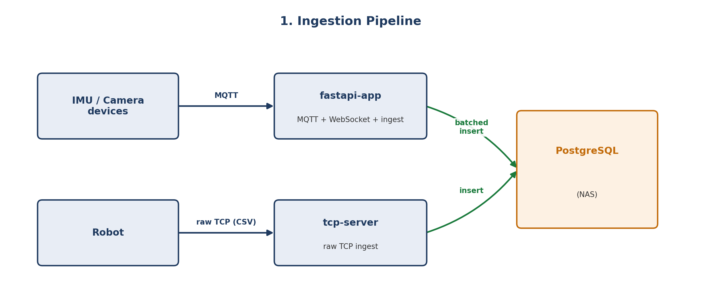
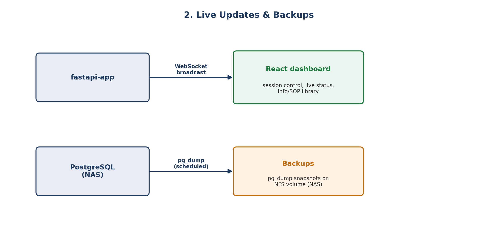
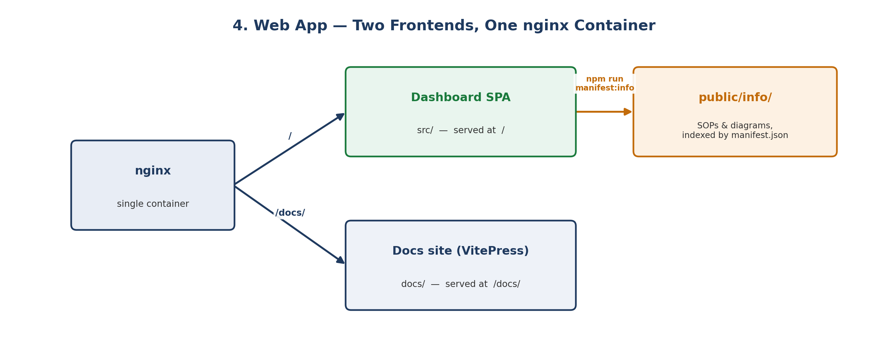

# How is this structured?

Almost everything runs in Docker containers. There are two groups of them, called **stacks**: an always-on stack on the AMS host, and an edge stack on the Raspberry Pis that the dashboard starts and stops for each run.

::: tip Interactive architecture diagram
The whole system is also drawn as a clickable, zoomable diagram at [/architecture/](/architecture/){target="_self"}: every machine, container and connection, with links to the code and these docs. It's built from the model in `web/architecture/`.
:::

## How data flows through the system

Edge devices never talk to the database directly. Everything goes through `fastapi-app` (IMU and camera data, over MQTT) or `tcp` (robot data, over a raw TCP socket). Both services use the same `db/database.py` module and the same PostgreSQL database on the NAS.

What happens to arriving data depends on the **capture mode** that `fastapi-app` owns and pushes to `tcp`: it's dropped when idle, shown live but not stored while monitoring, and stored only while a session is recording. See [Sessions & capture modes](/overview/capture-modes).

**Ingestion**: sensor data reaches PostgreSQL by one of two paths, depending on the device:



**Live updates & backups**: data feeds the dashboard in real time, and the database is backed up when each session stops:



## The two deployment surfaces

```text
 AMS host "IIoT" (192.168.2.100) — docker-compose.yml, always on
 ┌──────────────────────────────────────────────────────────────────────┐
 │  mqtt-broker   fastapi-app   tcp   web (nginx)   ntp   pgadmin        │
 │  stack-controller ── /var/run/docker.sock ──► Docker = Swarm manager  │
 └──────────────────────────────────────┬───────────────────────────────┘
                                        │ docker stack deploy / rm  (stack "edge")
                                        ▼
 Raspberry Pis — deploy/swarm-edge-nodes.yml, started per run from the dashboard
 ┌──────────────────────────────────────────────────────────────────────┐
 │  imu-106 … imu-111   one per IMU Pi, pinned by hostname (RPIIMUJ1 …)  │
 │  camera-front, camera-side   pinned by node label camera=front/side   │
 └──────────────────────────────────────────────────────────────────────┘
   IMUs and cameras publish MQTT to 192.168.2.100:1883
   The robot (FANUC controller) streams CSV to 192.168.2.100:5001 on its own
   PostgreSQL, backups and log files live on the Synology NAS (192.168.1.104)
```

1. **The broker stack** (`docker-compose.yml`) runs all the time on the AMS host: the MQTT broker, `fastapi-app`, the robot TCP server, the web dashboard, NTP, pgAdmin and `stack-controller`. See [Compose](/docker/compose).
2. **The edge stack** (`deploy/swarm-edge-nodes.yml`, stack name `edge`) is a Docker Swarm stack across the Pis, with one service per IMU and camera. It isn't left running. When you click Start Monitoring or Start Session, `fastapi-app` asks `stack-controller` to deploy it, with only the devices you selected. Stopping takes it down again. See [Swarm](/docker/swarm) and [Stack controller & device selection](/docker/stack-controller).

## The web app has two frontends

`web/` contains two separate sites, built independently and served by the same nginx container:

- **The dashboard SPA** (`src/`): the live operational UI. See [The dashboard](/overview/dashboard) for a tour. It also has an in-app "Info" document library (`public/info/`, indexed by `manifest.json`, which `npm run manifest:info` regenerates on every build).
- **This docs site** (`docs/`, VitePress): built separately with `npm run docs:build` and served under `/docs/` by nginx. It's for reference documentation rather than day-to-day operation.



## Where things live in the repository

| Path | What |
| --- | --- |
| `fast_server/` | `fastapi-app`: routes, MQTT ingestion, capture state, health, PLC listener, run parameters |
| `tcp_server/` | The robot TCP listener (its own container) |
| `db/` | Database access (`database.py`), `schema.sql`, and the hand-run migration log `migrations.md` |
| `common/` | The JSON log record every service writes |
| `stack_controller/` | The agent that deploys and removes Swarm stacks for `fastapi-app`, plus the container watchdog and log reader |
| `deploy/` | The edge stack (`swarm-edge-nodes.yml`) and its own `.env`. `deploy/depr/` holds the retired per-device stack files. |
| `web/` | Dashboard (`src/`), docs (`docs/`), nginx config |
| `mqtt_conf/`, `pgadmin/` | Broker config; pgAdmin account provisioning |
| `tests/` | `unittest` tests, run from the repo root |
| `plans/` | Design plans; finished ones are in `plans/completed/` |
